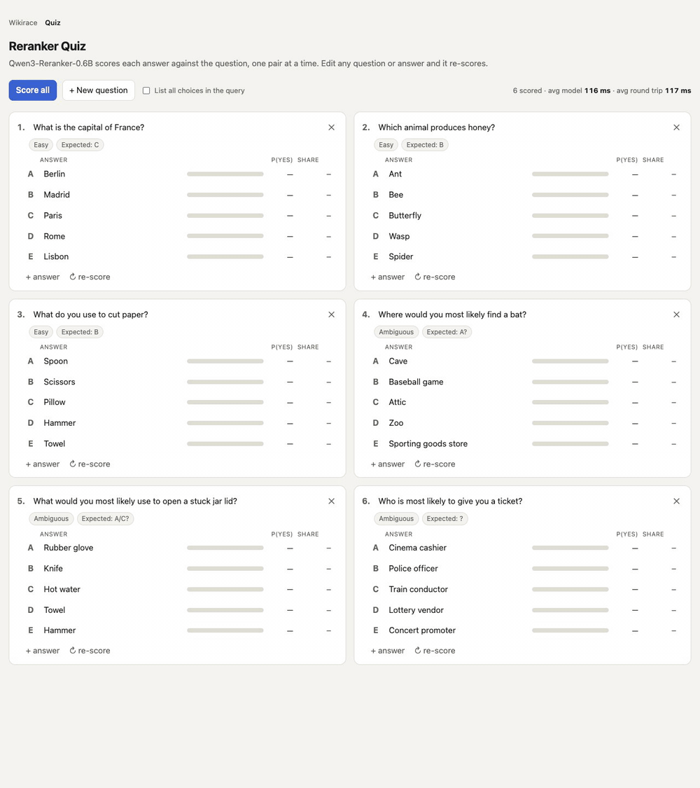
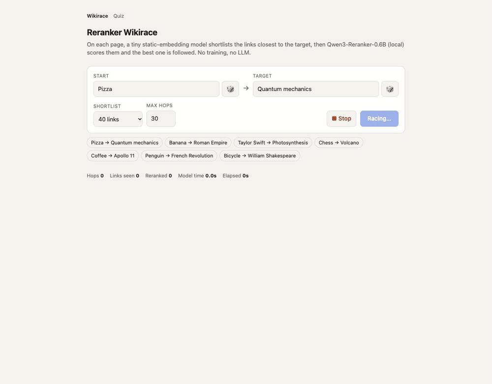
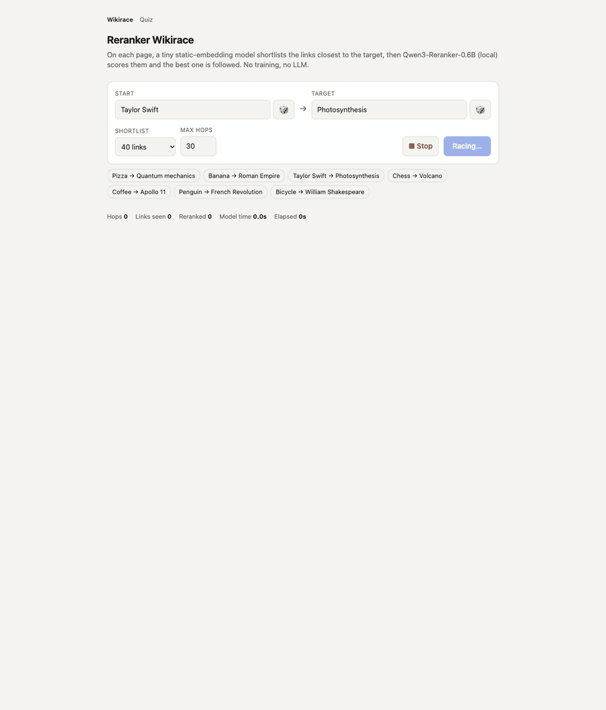
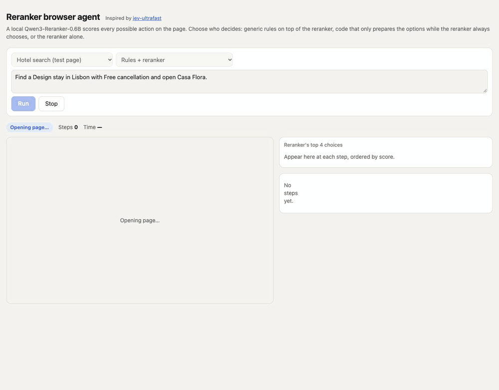
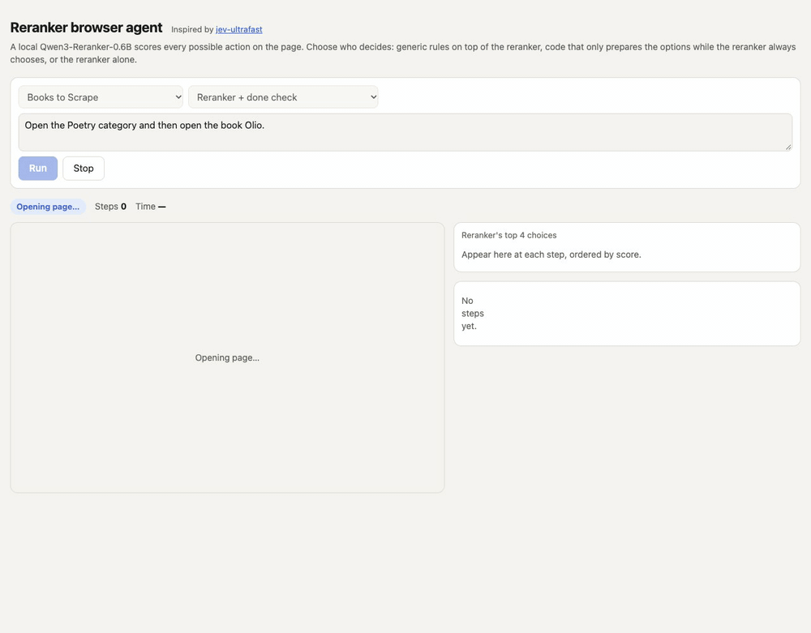
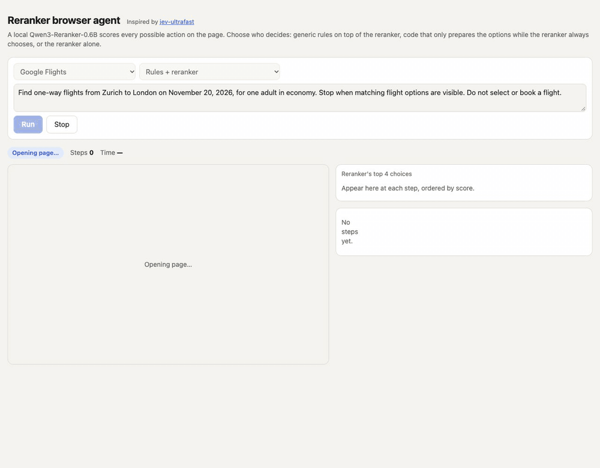

# RS-1 · Re-ranker Decision Model

**RS-1 uses a small, local reranker as a decision model.** A reranker is trained to answer one question: *how well does this document fit this query?* RS-1 turns decisions into exactly that question. Describe the situation as the query, describe each possible choice as a document, score them all, and take the top one.

- **Model:** [Qwen3-Reranker-0.6B](https://huggingface.co/Qwen/Qwen3-Reranker-0.6B), unchanged. No fine-tuning, no text generation, no API calls.
- **Runs on a laptop:** about 1.2 GB on Apple Silicon (MPS). On an M3 MacBook one option takes roughly 20–50 ms to score.
- **Output is a score per option** (the probability the reranker answers "yes"), so every decision comes with a full ranking you can inspect.

This repo walks through three uses, from simplest to hardest: a **multiple-choice quiz**, a **Wikipedia race**, and **browser use** on real websites.

---

## 1. Multiple-choice quiz

The question is the query, each answer is a document, and the highest-scoring answer wins. That's the reranker's home ground.



- **Easy questions:** the three easy questions are answered correctly and confidently (Paris, Bee, Scissors all score above 0.8).
- **Ambiguous questions:** the three ambiguous questions ("Where would you most likely find a bat?") get low, close scores. Low, close scores are a useful signal: the model is telling you it's unsure.
- **Speed:** all 6 questions, 30 answers, are scored in under a second, about 25–30 ms per answer.

Edit any question or answer in the page and it re-scores.

## 2. Wikipedia race

Get from one article to another by following links only. At each hop RS-1 collects every link on the current article, with each link's short description, and scores them all against the target ("is this article in the same field as the target, and would it link to it?"). It then follows the best unvisited one.

**Pizza → Quantum mechanics** in 3 hops, about 4 seconds:



**Taylor Swift → Photosynthesis** in 9 hops, with a long detour through thermodynamics before it finds Chloroplast (shown at 2× speed):



The reranker makes every choice. The code around it only does bookkeeping:
- if the target is linked from the current page, it goes straight there;
- it doesn't revisit pages;
- it ignores about 18 citation links that appear on almost every article (ISBN, DOI, PubMed…);
- optionally, a tiny embedding model ([potion-base-8M](https://huggingface.co/minishlab/potion-base-8M)) keeps only the closest 40 of the 300–1,500 links before the reranker scores them, for speed. Set the shortlist to "Off" to have the reranker score every link.

Routes aren't the shortest: RS-1 moves step by step towards the target's field rather than planning. But it gets there.

## 3. Browser use

RS-1 drives a real Chrome window. The agent loop, the way pages are turned into a list of possible actions, and the task set come from [jev-ultrafast](https://github.com/browser-use/jev-ultrafast) by Browser Use × TypeSafe. There, a trained decision model called **Jev** picks each action; here Jev is replaced by the local reranker. jev-ultrafast is used unmodified, as a submodule. RS-1 plugs into it from outside.

At every step, every possible action on the page (each link, button, field and dropdown option, plus wait, scroll and done) is a candidate. The reranker scores them against the goal, the page and the steps so far. The app shows the top 4, ordered by score, then the chosen one.

### Hotel search: *"Find a Design stay in Lisbon with Free cancellation and open Casa Flora."*

Rules + reranker mode (shown at 1.5× speed). Watch the step tags: for five steps the reranker wants to click "View Casa Flora" straight away, and the rules make it fill the destination and set the filters first. See the note on this below.



### Books: *"Open the Poetry category and then open the book Olio."*

Reranker + done check mode (shown at 1.5× speed). Every move here is the reranker's own top choice. The only other code is a check that recognises the goal page and stops.



### Google Flights: *"Find one-way flights from Zurich to London on November 20, 2026, for one adult in economy."*

Rules + reranker mode (shown at 3× speed).



**Flights needs help the reranker can't provide on its own.** RS-1 completes it reliably only with generic rules on top of the reranker (see below):
- the rules decide which value goes into which field (Zurich → "Where from?", the date → "Departure");
- they pick the autocomplete suggestion that matches what was typed;
- they open the ticket-type dropdown, because its value ("Round trip") isn't what the goal asks for;
- they recognise that the results page is the goal. At the last step of the recording, the reranker's own top choice was to click a flight (97%), which would have started a booking.

### What the reranker does, and what it doesn't

The app has four modes, so you can see exactly how much the reranker does alone:

| Mode | Who decides | Passed |
|---|---|---|
| **Rules + reranker** | reranker ranks every action; generic rules can override it | **14 of 14** |
| **Reranker + done check** | reranker chooses every move; code only checks whether the page is the goal | **6 of 14** |
| **Assisted** | code only prepares the options (removes repeats, describes hidden dropdown choices); reranker chooses | 2 of 6 main tasks |
| **Reranker only** | only the help jev-ultrafast gives Jev (its written instructions, the page, recent actions) | 0 of 6 main tasks |

On the hotel task, the reranker's instinct to open Casa Flora straight away isn't unreasonable: the hotel is visible from the start. But the task, from jev-ultrafast, deliberately requires the filters to be set, and its check verifies them. Their instructions to Jev say: "a matching result alone does not prove a requested filter was set."

With only the done check, the reranker solves most "find and open the right thing" tasks (all three Books and both Hacker News tasks, the article list, one of the two quotes tasks). It fails in four ways:
- on the hotel page it opens the right hotel straight away, skipping the filters the goal asks for;
- after typing a Wikipedia search it re-clicks the search box instead of picking a suggestion;
- it can't fill in the Flights form;
- once, it kept choosing a link it couldn't click and never thought to scroll.

Benchmark: jev-ultrafast's three tasks plus Wikipedia, Books to Scrape, Hacker News and quotes.toscrape.com, 14 tasks in all. 8 of them were written later and never used for tuning. Each result is checked independently against the final page, never by trusting the agent's own "done".

**What the reranker is good at:** finding the most relevant thing on a page. The right category, the right book, the right article, the right search text, the right option once a dropdown is open.

**What it can't do:**
- **Match values to fields.** It once rated typing "September 20" into "Where from?" at 0.95.
- **Recognise that it's finished.** Offered "Done" as one more option, it keeps choosing relevant links. Asked "is the goal achieved?" as a separate question, it stops too early: it can't tell "almost there" from "there".
- **Follow a sequence.** It doesn't treat "I typed the search, so now I pick the suggestion or press Search" as the next step. It tends to re-select the most relevant thing again.

These are what a trained decision model like Jev learns. RS-1 handles them with **generic rules**: no rule names a site, URL or button, and the same code runs on any URL you enter. But the rules depend on English words (month names, "from/to", "retry"), and they were written while watching these sites. In the app, every step is tagged with who decided it: the reranker, a rule the reranker agreed with, or a rule that overrode it, with what the reranker wanted instead.

**Speed:** about 3–6× slower than the times jev-ultrafast reports for Jev. For example, the hotel task takes 5–7 s against Jev's 1.9 s, and Flights about 40 s against 7 s. Most of that is scoring 10–40 options per step with a local 0.6B model. After each run, the app shows a breakdown of model, page-loading and browser time, and how many options were scored.

---

## Run it

Requirements: macOS with Apple Silicon (or a CUDA/CPU machine; it falls back automatically), [uv](https://docs.astral.sh/uv/), and Google Chrome.

```sh
git clone --recursive https://github.com/mattiaongit/rs-1-reranker-decision-model
cd rs-1-reranker-decision-model
uv sync
```

The model (about 1.2 GB) is downloaded from Hugging Face on first use. Run **one app at a time**, since each loads its own copy of the model.

**Quiz and Wikipedia race:**

```sh
uv run server.py        # Wikirace at http://127.0.0.1:8804, quiz at http://127.0.0.1:8804/mcq
```

**Browser use:**

```sh
./start_chrome.sh       # a separate Chrome with its own empty profile, remote debugging on port 9333
uv run local_jev.py     # the app at http://127.0.0.1:8766
```

The agent only drives that separate Chrome window, never your normal profile. Pick a site (or "Custom URL…"), a mode and a goal, then press **Run**.

**Benchmark:**

```sh
AGENT=rules uv run bench_jev.py            # main tasks; AGENT can be rules | pure_done | assist | pure
AGENT=rules uv run bench_jev.py held-out   # the 8 tasks written after tuning
```

## Files

| File | What it does |
|---|---|
| `reranker.py` | Qwen3-Reranker scoring. The shared query is processed once and its cache reused for every option, and only the "yes"/"no" outputs are computed. |
| `mcq.py`, `mcq.html` | the quiz |
| `wikirace.py`, `index.html`, `server.py` | the Wikipedia race, and the server for the quiz and the race |
| `local_jev.py` | plugs RS-1 into jev-ultrafast, serves the browser app (`agent.html`), human-like clicks, speed accounting |
| `decide.py` | rules + reranker mode |
| `pure_done.py`, `assist.py`, `pure.py` | the other three modes |
| `bench_jev.py` | benchmark with independent checks |
| `shortlist.py` | the optional embedding shortlist |
| `tools/record_gif.py` | records the GIFs in this README from the running apps |

## Credits

- [Qwen3-Reranker-0.6B](https://huggingface.co/Qwen/Qwen3-Reranker-0.6B) by the Qwen team.
- [jev-ultrafast](https://github.com/browser-use/jev-ultrafast) by Browser Use × TypeSafe (MIT): the agent loop, page snapshots, the hotel and research test pages, and the Flights task. RS-1's browser part is inspired by it and runs on top of it.
- [browser-harness](https://pypi.org/project/browser-harness/) for Chrome control, and [model2vec](https://github.com/MinishLab/model2vec) for the shortlist.
